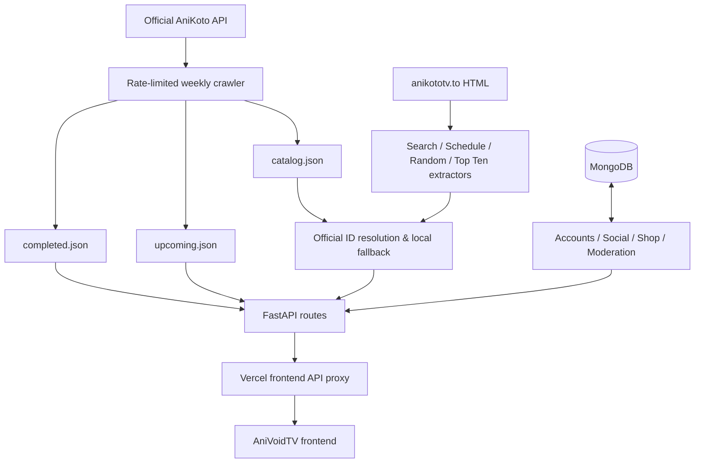

<div align="center">


### ⚡ The engine behind the Void

**A FastAPI-powered anime data gateway, weekly catalog crawler, and community backend.**

[](https://www.python.org/)
[](https://fastapi.tiangolo.com/)
[](https://www.mongodb.com/)
[](https://www.docker.com/)
[](https://render.com/)

[](#-api-reference)
[](#-intelligent-crawler)
[](#-security-architecture)
[](#-local-development)
[](#-credits--licensing)

[**Quick Start**](#-quick-start) · [**Endpoints**](#-api-reference) · [**Architecture**](#-system-architecture) · [**Deployment**](#-deployment) · [**Security**](#-security-architecture)

</div>

---

## ✦ Overview

**AniVoid API** is a custom API layer built on top of the **official [AniKoto public API](https://anikotoapi.site)**. The official API remains the primary source of anime catalog data; AniVoid fills in missing functionality using targeted extraction from `anikototv.to`, a locally maintained ID catalog, and scheduled JSON datasets.

Beyond anime discovery, its **v2 community layer** supports authentication, user profiles, watch lists, comments, uploads, a Void Points (VP) economy, cosmetics, moderation, and analytics. These account features require MongoDB; core anime endpoints can operate without it.

> [!IMPORTANT]
> **Source of truth:** AniKoto's official public API powers catalog ingestion. Scraped pages supplement the official data rather than replacing it. The project does **not** add creator or credit fields to API responses.

<div align="center">

| 📺 Anime discovery | 🔄 Catalog crawler | 👤 Community | 🛡️ Security |
|:---:|:---:|:---:|:---:|
| Search, schedule, random & top ten | Weekly atomic dataset rebuilds | Profiles, VP, shop & watch progress | Sessions, rate limits & upload validation |

</div>

## 🧭 Navigation

<details open>
<summary><b>Explore the documentation</b></summary>

- [System architecture](#-system-architecture)
- [API reference](#-api-reference)
- [Intelligent crawler](#-intelligent-crawler)
- [Accounts and community](#-accounts--community-v2)
- [Void Shop and VP economy](#-void-shop--vp-economy)
- [Security architecture](#-security-architecture)
- [Admin console and analytics](#-admin-console--analytics)
- [Quick start](#-quick-start)
- [Deployment](#-deployment)
- [Configuration](#-configuration)
- [Project structure](#-project-structure)
- [Credits and licensing](#-credits--licensing)

</details>

## 🧩 System architecture



The Vercel frontend proxy sends supported account and application requests to this backend. The proxy secret is shared between both deployments, while user cookies remain first-party to the frontend domain.

## 📡 API reference

| Method | Endpoint | Data source | Returns / purpose |
|---|---|---|---|
| `GET` | `/api/search?keyword=&page=` | `anikototv.to` | `id`, `poster`, `title` |
| `GET` | `/api/schedule?date=YYYY-MM-DD` | `anikototv.to` | `slug`, `id`, `title`, `japaneseTitle`, `poster`, `time`, `episode_no` |
| `GET` | `/api/random` | `anikototv.to` | `id`, `title`, `poster`, `type` |
| `GET` | `/api/top-ten` | `anikototv.to` | Today / week / month rankings with `id`, `title`, `rank`, `poster` |
| `GET` | `/api/completed?page=&per_page=` | `data/completed.json` | Finished-airing titles |
| `GET` | `/api/upcoming?page=&per_page=` | `data/upcoming.json` | Not-yet-aired titles |
| `GET` | `/api/status` | Local crawler state | Last crawl, next crawl, dataset sizes |
| `POST` | `/api/admin/refresh` | Admin operation | Triggers a crawl; requires `X-Admin-Token` |
| `GET`, `HEAD` | `/heartbeat` | Health endpoint | Keep-alive / uptime monitoring |
| `GET`, `HEAD` | `/health` | Health alias | Health check |
| `GET` | `/docs` | FastAPI | Interactive Swagger UI, unless disabled |

> [!NOTE]
> Schedule `id` and `poster` values are matched by title; unknown matches may be `null` or empty. See [`api_endpoints.md`](api_endpoints.md) (section 6) for the complete account and community endpoint reference.

<details>
<summary><b>📦 Response format</b></summary>

Successful responses use a consistent envelope:

```json
{
  "success": true,
  "results": []
}
```

Errors follow this structure:

```json
{
  "success": false,
  "message": "Error description"
}
```

The `results` content varies by endpoint. The JSON shown here illustrates the envelope, not a particular endpoint's full response.

</details>

<details>
<summary><b>🧪 Example requests</b></summary>

```bash
# Search anime
curl "http://localhost:8000/api/search?keyword=naruto&page=1"

# Airing schedule
curl "http://localhost:8000/api/schedule?date=2026-11-06"

# Completed anime
curl "http://localhost:8000/api/completed?page=1&per_page=20"

# Random title
curl "http://localhost:8000/api/random"

# Crawl status
curl "http://localhost:8000/api/status"

# Health check
curl -I "http://localhost:8000/heartbeat"
```

Manual refresh (requires a configured admin token):

```bash
curl -X POST "http://localhost:8000/api/admin/refresh" \
  -H "X-Admin-Token: YOUR_ADMIN_TOKEN"
```

</details>

## 🔄 Intelligent crawler

The weekly crawler (`app/crawler.py`) pages through the official `/recent-anime?per_page=100` endpoint and divides the results by status into two generated datasets. It also maintains `catalog.json` for slug-to-official-ID matching.

| Behavior | Implementation |
|---|---|
| Default request budget | **55 requests / 120 seconds** through a shared sliding-window limiter |
| Typical full crawl | About **90 requests / 2–3 minutes** |
| Scheduled refresh | **Sunday at 00:00** in `REFRESH_TZ` |
| Downtime tolerance | **1-hour** scheduler misfire grace |
| Data integrity | Deduplicate by `id`; build in memory; atomically replace files |
| Incomplete crawl protection | Keep previous files when a crawl fails or returns under **90%** of the reported total |
| Startup behavior | Skip initial crawl when both `completed.json` and `upcoming.json` exist |
| Optional staleness policy | `STALE_AFTER_DAYS=N` can trigger a boot-time recrawl |

<details>
<summary><b>🧠 Official ID mapping and fallback behavior</b></summary>

Site pages contain slugs such as `one-piece-odmau`, while the official API also supplies numeric IDs. `catalog.json` maps these slugs to official IDs.

- Search normalizes `animeId` to `id`.
- Top-ten results add `id` and rename `name` to `title`.
- Unknown slugs trigger a fetch of the newest 300 official records, at most once every 10 minutes.
- Search and random can fall back to page-scraped IDs for unknown slugs.
- If Cloudflare blocks the site, search and random can use the local catalog and return `X-Data-Source: local-catalog`.
- If `catalog.json` is missing at boot, it is reconstructed from completed/upcoming datasets; including the catalog improves matching.

</details>

<details>
<summary><b>🗓️ Manual and scheduled refresh</b></summary>

```bash
python -m app.crawler
```

Or call `POST /api/admin/refresh` with the `X-Admin-Token` header. The scheduled job runs every Sunday at midnight in the configured timezone; regenerated files become available a few minutes afterward.

</details>

## 👥 Accounts & community (v2)

The community features use **MongoDB**, including uploaded pictures (approximately **40 MB per user** by default). Without `MONGODB_URI`, anime discovery continues working while account endpoints return HTTP `503`.

| Category | Features |
|---|---|
| Identity | Display names distinct from `@handle`, Google sign-in option, account settings |
| Profiles | Public profiles, 30 avatars, 12 banners, main-picture selection, WebP re-encoding |
| Appearance | 8 free banner presets, animated decorations, titles and effects |
| Social | Comments, 8 animated reactions, sticker packs, reports |
| Tracking | Watch lists and synchronized Continue Watching |
| Progression | VP points, daily streaks, 6 ranks, 15 computed badges |
| Moderation | Reports, admin controls and audit tools |

### ✨ Void Shop & VP economy

<div align="center">

| 106 | 31 | 28 | 16 |
|:---:|:---:|:---:|:---:|
| **Avatar decorations** | **Animated banner scenes** | **Name effects** | **Card styles** |

| 34 | 5 | 40 | 8 |
|:---:|:---:|:---:|:---:|
| **Titles** | **Sticker packs** | **Original animated stickers** | **Animated reactions** |

</div>

Avatar decoration styles include wreaths, flower crowns, flames, crystals, halos, horns, crowns, wings, magic seals, auras, particles, and HUD frames.

**How users earn VP**

| Activity | Reward | Daily cap |
|---|---:|---|
| Welcome bonus | 50 VP | Once |
| Daily check-in | 10 + 2 per streak day (max 7) | Once daily |
| Episode watched | 5 VP | 100 VP |
| Comment | 3 VP | 15 VP |
| First time adding anime to list | 2 VP | 10 VP |

**Cosmetic rarity and prices**

| Rarity | Price | Rank requirement |
|---|---:|---|
| Common | 120 VP | — |
| Uncommon | 320 VP | — |
| Rare | 700 VP | Rank 1+ |
| Epic | 1,500 VP | Rank 2+ |
| Legendary | 3,200 VP | Rank 3+ |

Sticker packs cost **600–1,000 VP**. Values are configurable in `app/effects.py` and `app/progress.py`.

<details>
<summary><b>🎨 Regenerate frontend effects</b></summary>

After modifying effects, run the generator from the API project with the frontend directory located at the expected sibling path:

```bash
python tools/gen_effects.py ../AniVoidTV/assets/effects.css ../AniVoidTV/assets/fx-recipes.js
```

</details>

## 🛡️ Security architecture

AniVoid API includes several defensive layers:

- **Authentication:** scrypt password hashes; database-backed sessions; `HttpOnly` and `SameSite=Lax` cookies; secure `__Host-` cookie naming when applicable.
- **Session controls:** View/revoke sessions, sign out everywhere, and revoke other devices after password changes.
- **Brute-force defenses:** 15-minute lockout after 8 failed passwords, single-use server-issued captchas, and per-IP/user rate limits.
- **Request protection:** CSRF header on writes, request-size limits, constant-time token checks, and security headers.
- **Upload safety:** Pillow decodes and re-encodes images, strips metadata, guards against decompression bombs, and serves media with `nosniff` and a sandbox Content Security Policy.
- **Content restrictions:** Links are rejected in bios, display names, and comments.
- **Proxy boundary:** Frontend proxy allow-lists supported API areas and does not expose `/api/admin`.

> [!WARNING]
> The rate limiter and captcha cache are **in-process**. Run **one worker**. Password-only accounts do not have email recovery; users should keep their passwords safe or connect Google.

For more, see [`SECURITY.md`](SECURITY.md).

## 📊 Admin console & analytics

The admin interface is hosted on the frontend at:

```text
https://YOUR_FRONTEND_DOMAIN/AnimeVoid
```

**Not** `/admin`. Set up its credentials with:

```bash
python tools/admin_setup.py
```

Then configure the three generated values in your backend's Render environment. The console provides online device counts, installed apps, browser/platform/country analytics, traffic charts, member and report management, feature switches, audit logs, and a live security checklist.

See [`SECURITY.md`](SECURITY.md) and [`EXTENDING.md`](EXTENDING.md).

## 🚀 Quick start

### Prerequisites

- Python and `pip`
- A working network connection for upstream anime data
- MongoDB Atlas or another MongoDB deployment **if using account/community features**
- Optional: Docker for container deployment

### Local development

**1. Clone the project** (replace the placeholder with your actual repository URL):

```bash
git clone https://github.com/YOUR_USERNAME/YOUR_REPOSITORY.git
cd YOUR_REPOSITORY
```

**2. Create and activate a virtual environment**

```bash
python -m venv .venv
source .venv/bin/activate
```

On Windows:

```powershell
.venv\Scripts\activate
```

**3. Install dependencies**

```bash
pip install -r requirements.txt
```

**4. Configure environment variables**

```bash
cp .env.example .env
```

Edit `.env` for your timezone, admin token, and optional account/database configuration.

**5. Start the API**

```bash
uvicorn app.main:app --reload --port 8000
```

**6. Open the interactive API docs**

[http://localhost:8000/docs](http://localhost:8000/docs)

**7. Run offline tests**

```bash
pip install -r requirements-dev.txt
pytest
```

> [!TIP]
> Run one server worker in production because the scheduler and rate limiter are process-local.

## ☁️ Deployment

<details open>
<summary><b>🐳 Docker / Docker Compose</b></summary>

```bash
cp .env.example .env
# Edit .env first
docker compose up -d --build
```

The Compose setup stores data in the `api-data` volume.

</details>

<details>
<summary><b>🖥️ Ubuntu VPS / systemd / nginx</b></summary>

1. Copy the project to `/opt/anivoid-api`.
2. Create a virtual environment and install `requirements.txt`.
3. Configure `.env`.
4. Install and start the provided service:

```bash
sudo cp deploy/anivoid-api.service /etc/systemd/system/
sudo systemctl daemon-reload
sudo systemctl enable --now anivoid-api
```

5. Configure nginx using `deploy/nginx.conf` and enable HTTPS with Certbot (for example `certbot --nginx`). Review the provided service and nginx files for host-specific paths and domains.

</details>

<details>
<summary><b>🌐 Render + UptimeRobot</b></summary>

**Prepare datasets:** Generate `data/completed.json`, `data/upcoming.json`, and `data/catalog.json` locally using the crawler or by waiting for the initial run. Commit these files or store them on a persistent disk to avoid a crawl on every boot.

**Deploy:** Push to GitHub and create a Render Blueprint from `render.yaml`, or create a Web Service manually.

Build command:

```bash
pip install -r requirements.txt
```

Start command:

```bash
uvicorn app.main:app --host 0.0.0.0 --port $PORT --workers 1 --proxy-headers
```

Set `REFRESH_TZ`, `ADMIN_TOKEN`, and any other required environment variables.

**Monitor:** In UptimeRobot, create an HTTP(s) monitor for:

```text
https://YOUR_SERVICE.onrender.com/heartbeat
```

The source documentation recommends a **5-minute** interval. `/heartbeat` accepts both GET and HEAD.

> [!CAUTION]
> Render free-plan filesystems are ephemeral. A Sunday rebuild may be lost after restart/redeploy, reverting to committed JSON. Periodically update the repository datasets or use persistent storage. External uptime monitoring does not guarantee that a free service will remain awake under a provider's policies.

</details>

## ⚙️ Configuration

Use [`.env.example`](.env.example) as the authoritative configuration template. Key settings mentioned in the project documentation:

| Variable | Purpose |
|---|---|
| `REFRESH_TZ` | Timezone for Sunday 00:00 refresh (for example `Asia/Kolkata`) |
| `DATA_DIR` | Directory containing generated JSON datasets |
| `STALE_AFTER_DAYS` | Optional boot-time recrawl threshold; disabled by default |
| `ADMIN_TOKEN` | Secures admin operations and manual refresh |
| `MONGODB_URI` | Enables accounts, profiles, and community endpoints |
| `SESSION_SECRET` | Session signing; rotating it signs out users |
| `PROXY_SECRET` | Shared secret matching the Vercel frontend proxy |
| `GOOGLE_CLIENT_ID` | Optional Google OAuth Web client ID |
| `DISABLE_DOCS` | Set `true` to hide `/docs` in production |
| `CORS_ORIGINS` | Allowed browser origins |
| `SCRAPER_API_KEY` | Optional scraper assistance for blocked upstream requests |
| `FLARESOLVERR_URL` | Optional FlareSolverr service URL |

Generate a session secret:

```bash
python -c "import secrets;print(secrets.token_hex(32))"
```

> [!IMPORTANT]
> Never commit `.env`, secrets, private Google OAuth client-secret files, or session credentials. For Google login, configure your frontend origin under the OAuth client's **Authorized JavaScript origins**; only the public client ID is needed here.

For MongoDB Atlas, create a cluster and database user, then configure network access and place the connection string in `MONGODB_URI`. The original deployment instructions mention `0.0.0.0/0` for Render; restrict database network access more narrowly whenever your hosting setup allows it.

## 🗂️ Project structure

```text
AniVoid-API/
├── app/
│   ├── main.py           # FastAPI application and endpoints
│   ├── crawler.py        # Weekly official-API crawl
│   ├── extractors.py     # Search, schedule, random, top-ten parsing
│   ├── catalog.py        # Slug-to-ID map and local fallbacks
│   ├── scraper.py        # Mirror fallback / scraper support
│   ├── upstream.py       # Official API client and rate limiter
│   ├── scheduler.py      # Sunday scheduled job
│   ├── store.py          # Atomic JSON dataset storage
│   ├── accounts.py       # Authentication, captcha, profiles
│   ├── social.py         # Comments, lists, watch progress
│   ├── progress.py       # VP, ranks, badges
│   ├── security.py       # Passwords, tokens, rate limits
│   ├── media.py          # Picture upload and serving
│   ├── shop.py           # Void Shop purchasing/equipping
│   ├── effects.py        # Effects, titles, sticker catalog
│   ├── inventory.py      # Cosmetic ownership/eligibility
│   └── admin.py          # Reports and moderation
├── data/
│   ├── completed.json    # Generated finished anime data
│   ├── upcoming.json     # Generated upcoming anime data
│   └── catalog.json      # Generated slug-to-ID catalog
├── tools/
│   ├── gen_effects.py    # Generate frontend effects assets
│   └── admin_setup.py    # Admin credential setup
├── tests/                # Offline tests with mocked network
├── deploy/               # systemd and nginx templates
├── requirements.txt
├── requirements-dev.txt
├── .env.example
├── render.yaml
└── README.md
```

*The layout is based on the supplied project README. Some files, such as generated JSON datasets, appear only after setup or crawling.*

## ❓ Troubleshooting

<details>
<summary><b>Account routes return HTTP 503</b></summary>

Check that `MONGODB_URI` is configured and the MongoDB service is reachable. Anime-only routes can continue working without MongoDB.

</details>

<details>
<summary><b>Search or random stops returning scraped data</b></summary>

The upstream site may be blocking your host. The API can fall back to `catalog.json` and report `X-Data-Source: local-catalog`. Review optional scraper settings if necessary.

</details>

<details>
<summary><b>Scheduled refresh does not run on Render</b></summary>

Check `REFRESH_TZ`, process uptime, and whether the instance was sleeping at the scheduled time. The job has a one-hour misfire grace. You can run a manual refresh.

</details>

<details>
<summary><b>Changes to the dataset disappear after redeploy</b></summary>

Free Render instances use ephemeral storage. Update the committed JSON snapshots or configure persistent storage.

</details>

<details>
<summary><b>Unexpected sessions or captcha behavior with multiple workers</b></summary>

Use `--workers 1`: the scheduler, rate limiter, and captcha cache are in-process.

</details>

## 🤝 Credits & licensing

The scraper selectors are ported from **[Shineii86/AniKotoAPI](https://github.com/Shineii86/AniKotoAPI)** (MIT). The official [AniKoto API](https://anikotoapi.site) supplies the main catalog data. Please respect upstream services and their usage policies.

The supplied API README does not state a license for the **AniVoid API repository itself**. Add a repository `LICENSE` file if you want to define reuse and redistribution permissions; the upstream project's MIT license does not automatically establish a license for this repository.

<div align="center">

### ✦ Made for the AniVoid ecosystem ✦

[](https://t.me/quanxi_core)
[](https://t.me/Anime_Void_x)

<sub>Creator/community links are carried over from the AniVoidTV README context; they were not specified in the uploaded API README.</sub>

<br><br>

**ANIVOID API — POWERING THE VOID**


</div>
